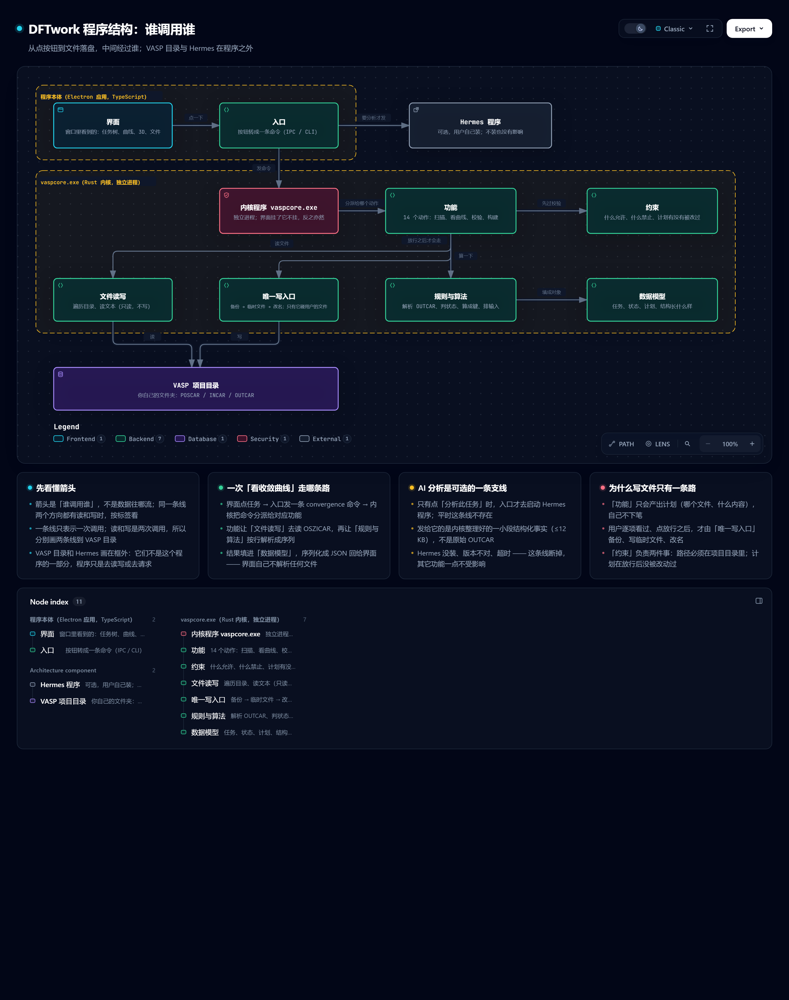
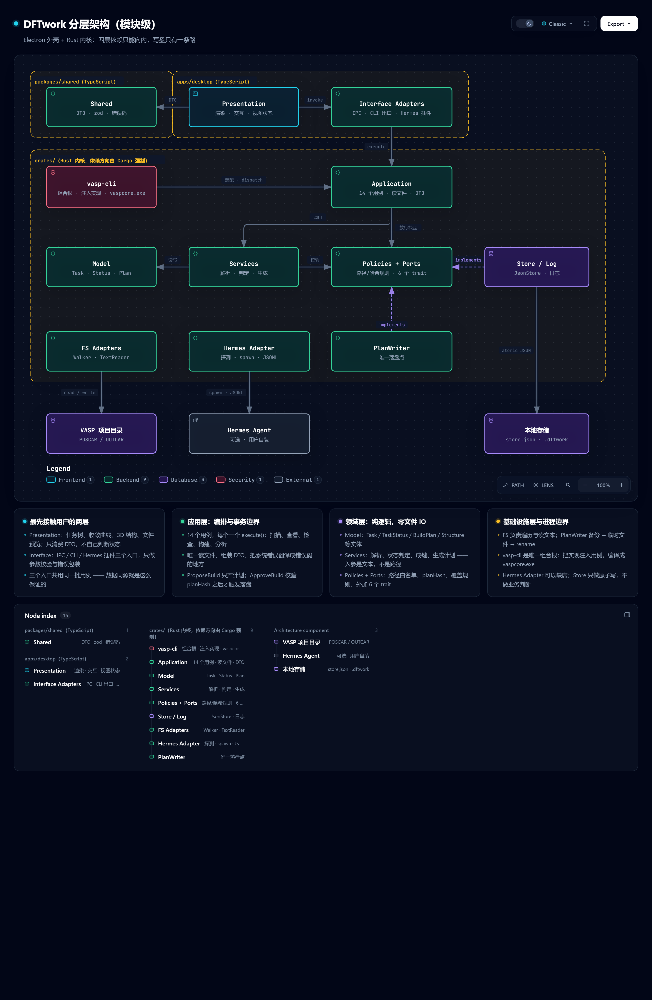

# 架构

> 架构决策始于 2026-10-27；实现状态同步于 2026-11-06。
> 本文区分 **当前实现** 与 **目标安全边界**。历史决策见 [decisions.md](decisions.md)，完成条件和修复顺序见 [roadmap.md](roadmap.md)。

## 1. 一句话

**Electron 壳 + `vaspcore`（Rust 内核，统一数据层）+ 可选 Hermes CLI；AI 当前只做文本分析，不直接写用户文件。**

分层的目的仍是：解析可脱离 Electron 与 Hermes 测试；UI、CLI 和 AI 消费同源事实；危险写操作集中在两阶段流程中。P0 单次写入、崩溃恢复、回滚与本机发布包已验收；外部 CLI 并发写入仍有独立边界。

## 2. 当前进程与调用关系

```text
┌──────────────────────── apps/desktop ────────────────────────┐
│ Renderer：React 18 + antd 5 + three 0.170 + recharts 2        │
│   任务/属性/对比/构建/Hermes 对话 + 结构/轨迹播放器          │
│        │ window.dftwork.*（contextBridge）                    │
│ Main：Node ESM                                                │
│   index.ts：桌面单实例锁、第二实例退出、首窗口恢复与聚焦       │
│   ipc.ts：Zod 入参校验、IPC handler、临时计划/回执/消息文件    │
│   core.ts：spawn vaspcore.exe、收集 stdout/stderr、超时        │
└──────┬────────────────────────────────────────────────────────┘
       │ JSON CLI
┌──────▼───────────────────────────────┐
│ vaspcore.exe                         │
│ scan / convergence / scene / ...     │
│ build / apply / rollback             │
│ analyze / hermes-chat / hermes-probe │
└──────┬───────────────────────────────┘
       │ analyze / hermes-chat 时再次 spawn
┌──────▼───────────────────────────────┐
│ hermes chat（用户自装，可选）         │
└──────────────────────────────────────┘
```

约束与现状：

- Renderer 不直接使用 Node `fs` 或 `spawn`；VASP 输入文件的构建、apply 和 rollback 都经 `vaspcore`。
- Electron Main 会为 CLI 写临时计划/回执 JSON 和 Hermes 消息文本，冒烟模式会写截图；这些不属于 VASP 业务文件写入。
- 当前没有独立 `ScannerWorker` 或持久化 `BuildQueue`；项目写入状态由 `BuildStore` 持久化，全局 `JsonProjectStore` 仍未接入最近项目等主流程。
- IPC 使用 TypeScript DTO，并在 Main 边界用 Zod 校验实际请求。
- Electron 在 `whenReady` 前获取桌面单实例锁；未获锁的第二实例退出，首实例收到事件后还原、显示并聚焦窗口。该机制不替代外部 CLI 并发写同一项目时的项目级锁。
- 扫描是一次性全量返回，不是文档早期设计的增量事件流。

## 3. 四层与真实依赖方向

```text
Presentation   project/apps/desktop/src/{renderer,preload}
                     │ IPC DTO（packages/shared）
Interface      project/apps/desktop/src/main + crates/vasp-cli
                     │
Application    crates/vasp-application
                     │ 调用 domain，声明 Fs 等所需能力
Domain         crates/vasp-domain（模型、解析、几何、策略、端口）

Infrastructure crates/vasp-infrastructure
                实现 application 的 Fs，也实现 domain 的 Clock/Logger/Hermes 等端口
                因当前代码实际依赖 vasp-application + vasp-domain
```

- `vasp-domain` 不依赖其他内部 crate，承载纯数据与领域逻辑。
- `vasp-application` 只依赖 `vasp-domain`，组织扫描、查看、构建、apply、rollback 和分析用例。
- `vasp-infrastructure` 提供本地文件系统、日志、时钟和 Hermes 适配器。
- `vasp-cli/src/main.rs` 负责分发，`commands/` 与 `support/` 完成实际装配；Electron 不直接引用 Rust crate。
- `packages/shared` 是 TypeScript DTO/IPC 常量层，不是 Rust domain 的依赖。

## 4. 当前 CLI 与数据流

### 4.1 扫描与查看

```text
openProject(root)
  → IPC scan → vaspcore scan <root> --max-depth <n>
  → 完整 ScanReport → 任务表与统计

selectTask(task)
  → convergence / scene / scf / forces / vibrations / magnetization / trajectory
  → 各面板按需消费 DTO
```

当前实现没有 `abspath + mtime + size` 增量缓存，也不保证大项目先返回前 50 条。扫描、结构、收敛与对比分别使用递增请求序号，只有最新请求可以更新界面状态；这是过期响应屏蔽，不是底层 IPC 调用取消。

### 4.2 属性与轨迹

现有 CLI 命令：

- 只读：`scan`、`convergence`、`scene`、`magnetization`、`scf`、`forces`、`vibrations`、`trajectory`、`compare`；
- 构建：`build`、`apply`、`rollback`；项目写入状态：`project-state`、`discard-plan`、`recover`、`prune-backups`；
- AI/系统：`analyze`、`hermes-chat`、`hermes-probe`、`version`。

文件树、文件预览、输入检查、模板发现等早期占位用例并未全部成为可用 CLI 能力，不能按占位文件数量宣称完成。

`convergence` 的 OSZICAR 与 OUTCAR 均通过 `Fs::scan_lines` 流式解析；OUTCAR 存在但读取失败会返回错误。`trajectory` 两遍扫描 XDATCAR，第一遍只计数，第二遍最多保留 600 个均匀样本和末帧，不在内存中累积完整轨迹。变胞重复头部会触发提示，但后段仍按首帧晶格转换。

### 4.3 AI：H1 任务分析 CLI + 项目对话 UI，不是 H2

```text
AnalyzeTask(task)
  → Rust 收集任务事实并组装固定分析 prompt → hermes chat

AiPanel(projectRoot)
  → IPC hermes-chat → vaspcore hermes-chat <root> <临时消息文件>
  → hermes chat --format stream-json ... [--resume <session_id>]
  → JSONL 文本/结果 → 对话消息、tokens 与耗时
```

对话子进程的 cwd 是当前扫描报告的项目 root；成功回答把 `session_id` 保存在 React 状态中供下一条消息续接，root 变化会清空消息和会话。聊天正文与会话 ID 仅保存在内存，页面重载或关闭即清空；localStorage 只保存模型名与提供方，暂不实现聊天历史持久化。Hermes 自己的会话存储不属于 DFTwork 的控制范围。当前没有 Hermes 插件工具面，不开放文件写入或终端工具，也不会自动把任务事实附到自由消息中。

Electron 解析并设置 `HERMES_BIN`；探测、任务分析和对话都使用该变量，CLI 还可用 `--hermes-bin` 显式覆盖。详细命令、事件和实测边界见 [hermes-contract.md](hermes-contract.md) 与 [m3-probe-findings.md](m3-probe-findings.md)。

## 5. 构建写入：P0 持久化与崩溃恢复已落地

当前流程：

```text
build(source, target, overrides, root)
  → BuildPlan + 原子保存 .dftwork/plans/pending.json
  → UI diff → 用户放行
  → apply(plan JSON) → 全量预检 → 备份覆盖项 blobs
  → 保存 manifest.json + journal.json → 原子写业务文件
  → 提交 .dftwork/receipts/index.json → 删除 journal 与对应 pending → 保留策略

project-state(root) → 找回 pending、最近 100 条回执、恢复通知和备份占用
recover(root)      → 未提交则校验并恢复整批；已提交则保留文件与回执并完成清理
rollback(receipt)  → 校验路径/后像/备份 → 原子还原或删除新建项 → 标记已回滚
```

已实现的安全约束：

- `planHash` 绑定 root、路径、动作、目标内容和 `previous_content`；apply 预检全部条目并在写入时复查，失败时反向补偿；
- apply/rollback/recover 共用 root 规范化与真实路径检查，拒绝符号链接逃逸；`.dftwork` 是保留元数据目录，业务计划不能自写状态与恢复数据；
- 在任何业务文件修改前，覆盖项原内容、manifest 和包含完整计划/回执的 journal 均已持久化；中途崩溃可由 `project-state` 发现、`recover` 幂等续接；
- 未提交恢复会先校验所有目标，后续人工修改会阻止自动恢复；已提交中断不会误回滚已经生效的批次；
- 回执记录完整 `applied_hash`，rollback 校验当前内容和备份 blob；旧 `backup/...` 回执继续兼容，缺少后像的旧回执安全拒绝；
- 每文件 5 版、500 MB、30 天与最近 100 条回执在写入/回滚后执行，也可在 UI 手动清理；含 journal 的批次受保护，失去备份的回执明确标为不可回滚；
- 8 项持久化/故障注入 CLI 回归、10 项原有写入回归及真实 Electron 的 pending 重载、UI 崩溃恢复、apply→重载→rollback 均通过。

## 6. 写入安全边界与剩余工作

1. 单次批准只绑定批准时的 root 与磁盘前像，不是全局写权限；后续修改会触发冲突。
2. 项目备份有保留上限，清理后历史回执只作审计记录，不能假定永远可回滚；重要数据仍需独立备份。
3. 桌面单实例锁已验收：第二实例退出，首窗口恢复并聚焦。该锁不覆盖外部 CLI 或其他进程对同一项目的并发写；这类并发仍不宣称安全。
4. 普通 UI 写入恢复/回滚与桌面单实例已沉淀为永久 Electron 回归；0.2.0 NSIS / portable 本机启动、扫描、内核和许可实物已验收。远端 CI、真实固定任务分析、H2 工具面及其他干净 Windows 机器验收仍属后续工作。

## 7. 渲染与前端状态

- `SceneRenderer` 接口与 `ThreeRenderer` 已实现，结构视图和轨迹播放器均直接创建 `ThreeRenderer`。
- 当前没有渲染器注册表、运行时多实现切换或完整 `renderer.impl / style / effect / quality` 配置。
- 原子、晶胞、成键、PBC 和轨迹播放已有实现；界面状态主要在 React 内存中。
- 扫描、结构、收敛和对比分别通过递增序号忽略过期响应；新扫描及勾选变化会使相关旧请求失效，对比加载状态独立。手动和自动构建均已使用当前扫描报告的 `report.root`，不再使用启动时的 `bootProject`。

## 8. 存储与备份

当前可确认的实现：

- 项目写入状态由 application 层 `BuildStore` 通过 `Fs` 管理，pending、回执索引、manifest 和 journal 均使用原子替换；
- 覆盖项 blob 位于 `.dftwork/backup/<批次>/blobs/`，回执位于 `.dftwork/receipts/index.json`；pending 最多一个，回执最多 100 条；
- apply/rollback/recover 后执行 5 版 / 500 MB / 30 天保留策略，构建页显示占用并可手动清理；不可用回执保留原因；
- Electron 临时保存计划/回执 JSON 以调用 CLI，结束后删除临时文件；这些临时文件不承担找回功能；
- 全局最近项目、会话映射、视图状态和 `%APPDATA%/DFTwork/store.json` 仍未形成统一主流程，Hermes 聊天也仍只在 React 内存中。

ADR-007 的全局 Store 仍有缺口，桌面单实例锁已落地并通过真实双进程验收；外部 CLI 并发写仍需独立约束。ADR-009 的项目写入状态与备份保留已落地，实际状态以本节和 roadmap 为准。

## 9. 目录落位

```text
DFTwork/
├── docs/
├── project/
│   ├── apps/desktop/src/       main / preload / renderer
│   ├── crates/
│   │   ├── vasp-domain/
│   │   ├── vasp-application/
│   │   ├── vasp-infrastructure/
│   │   └── vasp-cli/
│   ├── packages/shared/
│   ├── reference/VASPFlow/     只读参考与对拍来源，不参与构建
│   ├── scripts/
│   └── tests/
└── CONTEXT.md
```

## 10. 测试现状与目标

| 范围 | 当前事实 | 尚需补齐 |
|---|---|---|
| Rust | 128 项通过，含 10 个写入安全、8 个持久化/故障注入、2 个解析和 11 个契约 CLI 集成测试 | 更多真实文件、全字段对拍与外部进程并发写入回归 |
| 前端 | typecheck 与生产构建通过；真实生产 React/preload + 可控模拟 IPC 的四类乱序场景已有永久回归 | 补真实后端延迟、其他属性面板和更多交互自动化 |
| Electron | 4 组永久场景及真实付费 Hermes 两轮续接通过；0.2.0 解包版、NSIS 安装版和 portable 均在隔离用户目录完成启动与扫描 | 真实固定任务分析、H2 工具面、其他干净 Windows 机器、代码签名和更多永久 UI 自动化 |
| 对拍 | 3 个入库合成 fixture 通过；显式清单缺失即失败，golden 确定性重建无差异；逐步比较离子步编号、能量和全部力值 | 状态、路径、应力、结构及更多真实文件比较 |
| 静态与供应链 | 全 workspace 版本为 0.2.0；Electron 42.11.16 构建及四组 E2E 通过，pnpm 生产/全量审计均为 0；包内内核及 `resources/licenses/` 三份许可已核验 | 远端 CI、格式化、clippy 与 cargo audit 尚未验收 |

早期设计图仍可用于理解目标分层，但其中 ScannerWorker、BuildQueue 等不应按当前实现读取：





## 11. 验收与文档同步规则

- 新功能只有在真实命令或界面路径通过验收后，才标记“完成”；类型检查或占位结构不算功能完成。
- 修改 ADR 所约束的行为时，先更新决策记录；只补实现状态时更新本文和 roadmap，不改写历史决策。
- CLI/IPC/Hermes 契约变化必须同步对应文档和契约测试。
- 每次同步文档时至少核对：里程碑、写入安全声明、测试数量、对拍覆盖、打包状态和许可声明。
