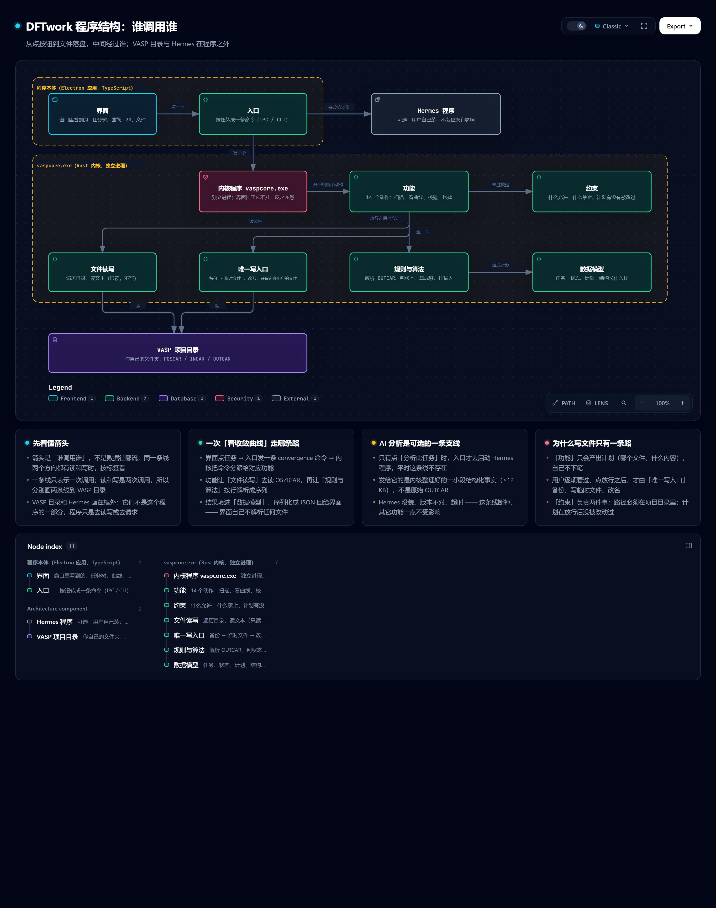
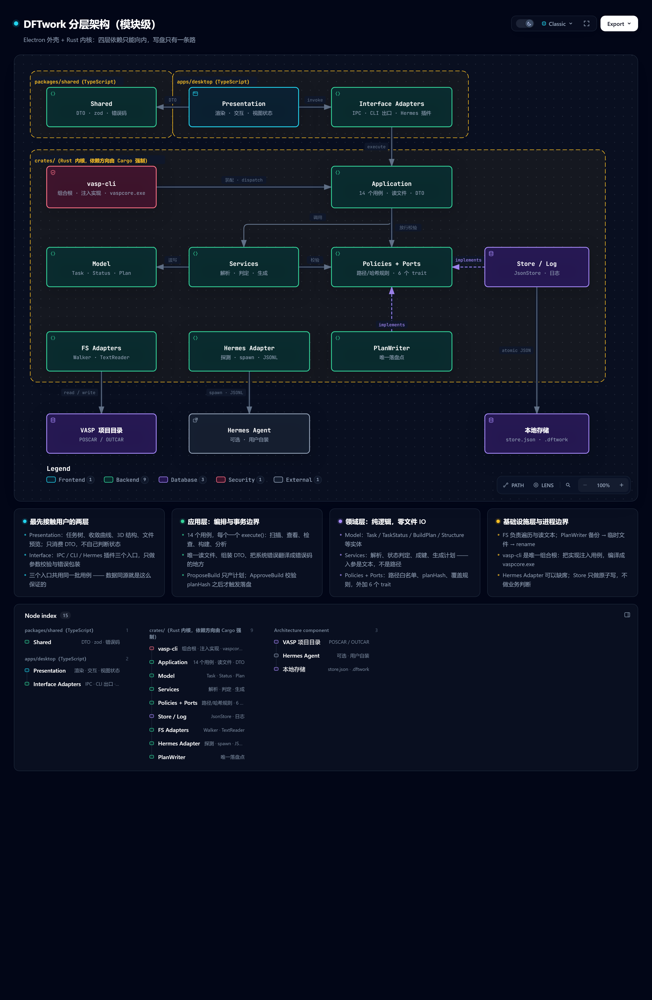

# 架构

> 定稿于 2026-10-27。任何偏离本文的改动，先在 [decisions.md](decisions.md) 加一条 ADR。
> 术语（任务、计划、放行、端口、对拍…）见 [../CONTEXT.md](../CONTEXT.md)。

## 1. 一句话

**Electron 壳 + `vaspcore`（Rust 内核，唯一数据层）+ HermesAdapter（可选 AI 通道）；AI 永远不直接写用户文件。**

复杂度不在 UI，也不在解析算法，而在四条边界：解析要能脱离 Electron 与 Hermes 单测；Hermes 可能缺席或变形；写文件只能有一个入口；同一份解析结果要被界面、CLI、AI 工具三方消费。分层就是把这四条变成结构约束。

## 2. 两张图



> 白话标注：每一块**是干什么的**、**被谁调用**、**为什么 VASP 目录和 Hermes 画在框外**。



> 每层的文件落位与依赖方向。

## 3. 运行视角：进程与线程

```
┌──────────────────────────── apps/desktop ─────────────────────────────┐
│ Renderer（React 18 + antd 5 + three 0.160 + recharts 2）               │
│   Panel / FileList / ConvergenceChart / StructureViewer                │
│   + BuildPlanReview（首版新增：计划 diff 与放行）                       │
│        │ window.dftwork.*（contextBridge，类型来自 packages/shared）    │
│ ───────┼────────────────────────────────────────────────────────────── │
│ Main（Node 20 ESM）                                                    │
│   ├ IpcRouter      zod 校验入参 → spawn vaspcore.exe → 包装错误        │
│   ├ ProjectStore   最近项目 / 视图状态 / 会话映射（JSON 原子写）         │
│   ├ BuildQueue     计划暂存 → 放行 → 落盘 → 回执 / 回滚                 │
│   ├ HermesAdapter  能力探测 / spawn / JSONL 解析 / 会话续接             │
│   └ ScannerWorker  目录遍历放 worker_threads，不阻塞界面                │
└──────┬───────────────────────────────────┬────────────────────────────┘
       │ spawn + JSON（stdin/stdout）        │ spawn（可选，用户自装）
┌──────▼──────────────────┐        ┌───────▼──────────────────────────┐
│ vaspcore.exe            │        │ hermes chat --format stream-json │
│ Rust 内核，进程隔离      │        │ 只读工具面；缺席时一切照常         │
└─────────────────────────┘        └──────────────────────────────────┘
```

| 位置 | 职责 | 禁止 |
|---|---|---|
| Renderer | 渲染、交互、本地视图状态 | 直接 `fs`、直接 `spawn` |
| Main | **唯一**文件写者、**唯一**子进程启动者、IPC 校验 | 在 UI 线程做长遍历（交 worker） |
| ScannerWorker | 目录遍历、快速解析、增量事件 | 写文件 |
| `vaspcore.exe` | 解析、判定、生成计划、执行落盘 | 联网、弹窗、读用户配置 |
| Hermes 子进程 | 推理与只读工具调用 | 触碰用户文件（工具面禁止） |

**"唯一写者"是安全边界，不是风格偏好**：只有 Main 里的 `BuildQueue` 能落盘，"每次修改必须用户放行"就只需在一处强制。

**内核走独立进程而不是 napi 原生模块**：崩溃只挂自己、Electron 升级不用重编、命令行可直接调试；代价是每次 5–20 ms 进程启动，相对读几十 MB OUTCAR 可忽略。

## 4. 四条数据流

**扫描**（增量，不等全量）

```
openProject(root) → IpcRouter 校验 → ScannerWorker
  → vaspcore scan --root <path> --stream   （逐行 JSON 事件）
  → 任务树 / 状态统计   缓存键 = abspath + mtime + size
```

大目录先出前 50 个，边扫边补；缓存键避免重复解析 OUTCAR 尾部。

**查看**（按需，选中才算）

```
selectTask(id) → convergence / structure-scene / task-files / read-file 四条独立命令
```

**分析**（可选）

```
clickAnalyze(id, intent) → vaspcore bundle --task <id>   → ≤12 KB 结构化事实
  → HermesAdapter: hermes chat --query-file - --format stream-json --source tool -Q
                    [--resume <id> | --continue <key>]
  → 逐行 JSONL → tool 卡片 / 流式文本 → result 存 session_id + tokens
```

Hermes 不存在、版本不符、超时、退出码非 0 —— 只让这次分析失败，查看功能不受影响。契约见 [hermes-contract.md](hermes-contract.md)。

**构建（写）** —— 全程两阶段，规则不写在 UI 里

```
AI 调 vasp_build_inputs 或 用户点「批量构建」
  → vaspcore build --dry-run           → BuildPlan（不落盘）+ planHash
  → BuildQueue.pending(plan)           → UI: BuildPlanReview（逐文件 diff、冲突标记）
  → 用户逐项勾选 + 点放行 → 校验 planHash 未变
  → vaspcore build --apply <planHash>  → 写前备份 → 落盘 → 回执
```

四条硬规则：

1. **计划即凭据**：放行绑定 `planHash`，计划内容任何变化自动失效。
2. **路径白名单**：所有目标必须落在项目根内，`..` 与绝对路径一律拒绝。
3. **写前备份**：只备份被覆盖的文件，内容寻址去重，排除 POTCAR/WAVECAR/CHGCAR；每（任务,文件）留 5 版、项目上限 500 MB、30 天过期。详见 [ADR-009](decisions.md#adr-009-备份用内容寻址--保留上限不做逐文件时间戳目录)。
4. **不静默覆盖**：默认"存在即冲突"，由用户在 diff 面板选覆盖或跳过。

## 5. 代码视角：四层与依赖方向

```
① Presentation   apps/desktop/src/{renderer,preload}     只认 DTO
② Application    crates/vasp-application                 14 个用例
③ Domain         crates/vasp-domain                      纯逻辑，零 IO
④ Infrastructure crates/vasp-infrastructure              实现 domain 的 trait
                                    ↑ 依赖倒置
横切：packages/shared（DTO / zod / 错误码）· interface（IPC / CLI / Hermes 插件）
```

| 层 | 可以依赖 | 禁止依赖 |
|---|---|---|
| ① Presentation | `shared` | domain、application、infrastructure、electron 主进程、`node:fs` |
| ② Application | domain、`shared` | infrastructure 具体类、electron、`node:fs`、`node:child_process` |
| ③ Domain | `shared`（仅类型）、`node:path`（纯计算） | application、infrastructure、electron、`node:fs`、`child_process`、`http` |
| ④ Infrastructure | domain 的端口、`shared` | application、presentation |
| interface | application、`shared` | infrastructure 具体类（由组合根注入） |

`node:path` 允许出现在 domain：纯字符串计算，不产生 IO。`node:fs` 不允许——这是真正的边界。

### 5.1 Domain：VASP 领域知识本身

```
model/      Task, TaskStatus, StatusEvidence, InputCheck,
            ConvergenceSeries, Structure, BuildPlan, BuildItem, AnalysisBundle
services/   TaskDetector      目录项 + 读文件回调 → 任务或 null
            StatusClassifier  输出事实 → TaskStatus + evidence
            ConvergenceParser OSZICAR/OUTCAR 文本 → 序列
            StructureBuilder  POSCAR/CONTCAR 文本 → scene
            InputValidator    输入文件文本 → InputCheck
            InputPlanner      源结构 + 参数 → BuildPlan（不落盘）
            AnalysisBundler   任务/序列/校验 → Bundle ≤12 KB
policies/   PathPolicy        目标必须在项目根内
            PlanHashPolicy    planHash 计算与比对
            OverwritePolicy   存在即冲突，需逐项确认
ports/      HermesPort, ProjectStorePort, FileWriterPort, ClockPort, LoggerPort, EventSinkPort
```

约定：所有 service 入参是**文本或纯数据**，不是路径（路径式包装留在 application）；不抛 `ENOENT` 这类系统错误，只抛领域错误（`InvalidStructure`、`PotcarOrderMismatch`、`PlanHashMismatch`）；测试用字符串夹具，毫秒级。

**成键算法是这里最脆的一环**（原 385 行纯逻辑）：晶格、元素半径、周期边界任一细节错，3D 就画错。它必须有自己的夹具（多种晶格 × 元素 × 边界情形），逐原子逐键比对，不与别的模块混测。

### 5.2 Application：14 个用例

| 用例 | 输入 → 输出 | 依赖 |
|---|---|---|
| `OpenProject` | root → `ProjectSummary` | TaskDetector、Store |
| `ScanProject` | root → `AsyncIterable<TaskSummary>` | TaskDetector、Walker |
| `InspectTasks` | ids → `TaskDetail[]`（含 evidence） | StatusClassifier |
| `GetConvergence` | id → `ConvergenceSeries` | ConvergenceParser + Reader |
| `GetStructureScene` | id + 文件名 → `StructureScene` | StructureBuilder + Reader |
| `ListTaskFiles` | id → `FileTree` | Reader |
| `ReadTaskFile` | id + 文件名 → `TextPreview`（500 KB 截断） | Reader |
| `CheckInputs` | ids + profile → `InputCheck[]` | InputValidator + Reader |
| `DiscoverInputs` | root + maxDepth → `DiscoveryReport` | SrcInspect + Walker |
| `ScanTemplates` | root + maxDepth → `TemplateCandidate[]` | TemplateScanner + Walker |
| `ProposeBuild` | targets + options → `BuildPlan`（pending） | InputPlanner、PathPolicy |
| `ApproveBuild` | planHash + 逐项选择 → `BuildReceipt` | PlanHashPolicy、Writer |
| `AnalyzeTask` | id + intent → `AsyncIterable<AnalysisEvent>` | AnalysisBundler、HermesPort |
| `ContinueAnalysis` | sessionId + msg → `AsyncIterable<AnalysisEvent>` | HermesPort |

约定：一个用例一个文件，导出 `execute()`；依赖构造注入，不 `new` 基础设施；错误在这里翻译成 `AppError`（`VALIDATION` / `NOT_FOUND` / `CONFLICT` / `EXTERNAL` / `TIMEOUT`）；返回 DTO，不把领域实体直接丢给 UI。

### 5.3 Infrastructure：只做转换与传输

| 适配器 | 实现 | 说明 |
|---|---|---|
| `LocalFs` | `vasp_application::ports::Fs` | 遍历、读文本、尾部读取；UTF-8 失败退 GBK |
| `PlanWriter` | `FileWriterPort` | 备份 → 写临时 → rename → 回执；**唯一落盘点**（M4，未实现） |
| `HermesCliAdapter` | `HermesPort` | 探测、spawn、JSONL 解析、会话、超时 |
| `JsonProjectStore` | `ProjectStorePort` | 原子写、最近项目、会话映射 |
| `FileLogger` / `SystemClock` | `LoggerPort` / `ClockPort` | 分级轮转 / 可注入固定时间 |

不含业务判断：是否收敛、是否覆盖、路径是否合法，全在 domain。

### 5.4 Presentation

`renderer/api.ts` 是唯一数据入口，把 `window.dftwork.invoke(...)` 包成类型化方法。组件只消费 DTO；状态文案由后端给（`status.label`），前端不写 if-else 判状态；视图状态（选中、面板宽度、tab）只在本地。

**画质与渲染接口**：Electron 与 Tauri 都跑 Chromium，渲染无实质差别，差别只在浏览器版本可控性——Electron 一致，Tauri 随系统 WebView2。基线：设备像素比自适应、抗锯齿开、成键用实例化网格、500 原子 60 fps、松开鼠标才重绘。界面**不直接操作 three.js**，只通过 `SceneRenderer` 接口（`setStructure` / `setStyle` / `capture` / `dispose`），未来加光晕、深度雾、卡通描边只换实现。见 [ADR-011](decisions.md#adr-011-渲染抽象成-scenerenderer-接口界面不直接依赖-threejs)。

### 5.5 Interface（横切）

四个入口，都很薄：IPC（zod 校验 → 调用例 → 包装错误）、CLI（clap → 调用例 → JSON）、Hermes 工具（tool schema → 调 CLI → JSON）、未来 HTTP/ACP（同模式）。

## 6. 端口：6 个，不多不少

`trait` 定义在 `vasp-domain/src/ports/`，实现在 `vasp-infrastructure`。**只有需要替换或需要 mock 的才端口化。**

| 端口 | 方法（示意） | 为什么 |
|---|---|---|
| `HermesPort` | `probe()` / `analyze(req)` / `resume(id,msg)` | 会缺席、会升级、测试要造流 |
| `ProjectStorePort` | `load()` / `save(patch)` / `getSession(hash)` | 实现可能换（JSON → SQLite） |
| `FileWriterPort` | `apply(plan) → Receipt` / `rollback(receipt)` | 写盘是唯一危险动作，必须可断言 |
| `LoggerPort` | `debug/info/warn/error` | 测试静音 |
| `ClockPort` | `now()` | 时间戳断言 |
| `EventSinkPort` | `emit(event)` | 扫描/分析进度回推 |

**不端口化的**：文件读取与目录遍历。VASP 任务的本质就是"读某一组文件"，换文件系统没有真实场景；端口化进 domain 只会让 2,600 行各多一层包装。Rust 里 application 又不能直接引用 infrastructure（依赖方向会反），所以实际做法是：**application 自己声明 `Fs` trait**（`vasp_application::ports::Fs`，只有 `list_dir` / `read_text` / `read_tail` / `exists` 四个方法），infrastructure 的 `LocalFs` 实现它，组合根注入。语义上它仍是"应用层自己要的工具"，不是业务端口，也不进 domain。

## 7. 组合根

唯一装配实现的地方是 `crates/vasp-cli/src/main.rs`：

```rust
let store  = JsonProjectStore::new(store_path)?;
let reader = TextFileReader;
let walker = DirWalker::new(4);
let writer = PlanWriter::new(".dftwork/backup")?;
let hermes = HermesCliAdapter::probe(&config)?;   // 缺席则返回 None

let app = App {
    scan_project:  ScanProject::new(&walker),
    convergence:   GetConvergence::new(&reader),
    propose_build: ProposeBuild::new(&reader, &clock),
    approve_build: ApproveBuild::new(&writer, &store),
    analyze:       AnalyzeTask::new(&reader, &hermes, &store),
    // …
};

dispatch(cli.command, &app)   // clap 子命令 → 用例 → JSON 输出
```

Electron 侧只做「spawn `vaspcore.exe` + 解析 JSON + 转发事件」，不含业务装配。**内核与界面的唯一耦合点是 CLI 契约**，因此换壳、加 CLI 用法、给超算当命令行工具都不必动界面。

## 8. 目录

```
DFTwork/
├── apps/desktop/src/          main（spawn + IPC）· preload · renderer（React）
├── crates/
│   ├── vasp-domain/src/       model / services / policies / ports
│   ├── vasp-application/src/  use_cases / dto / errors
│   ├── vasp-infrastructure/   fs / hermes / store / logging
│   └── vasp-cli/src/main.rs   组合根 → vaspcore.exe
├── packages/shared/src/       DTO / IPC schema / 错误码（TS）
├── packages/shared/prompts/   analyze.md（AI 提示词）
├── reference/VASPFlow/        原 JS（只读，生成对拍基准，不参与构建）
├── tests/                     fixtures / golden / parity.rs
├── plugins/hermes-vaspflow/   二期：Hermes 工具插件
└── docs/
```

Rust 用 4 个 crate 而不是一个 crate 分目录：Cargo 的 crate 边界是**编译期强制**的——`vasp-domain` 的 `Cargo.toml` 不写内部依赖，它就物理上无法引用上层。比 lint 规则硬得多。

## 9. 两条关键走查

**分析任务**——业务判断全在 domain，IO 全在 infrastructure，编排全在 application，界面只收事件。

```
UI clickAnalyze → ipc.invoke            [Interface]
 → AnalyzeTask.execute()                [Application]
     reader.read_oszicar / outcar_tail  [Infrastructure]
     ConvergenceParser.parse(text)      [Domain, 纯]
     StatusClassifier.classify(facts)   [Domain, 纯]
     AnalysisBundler.build() → ≤12 KB   [Domain, 纯]
     hermes.analyze(bundle, key)        [Port → Infrastructure]
 → emit(text | tool | result)           [EventSink]
```

**构建与放行**——放行校验是领域规则，所以 CLI、AI 工具、界面调同一个用例时规则自动生效。

```
ProposeBuild → reader 读源结构 → InputPlanner.plan()（纯）→ PathPolicy 校验
  → pending plan + planHash（不落盘）

用户勾选放行

ApproveBuild → PlanHashPolicy.assert_match → writer.apply() 备份+写入+回执 → store 记录
```

## 10. 约束怎么强制

**Rust 侧：Cargo 物理强制。** `vasp-domain/Cargo.toml` 不写内部依赖就无法引用上层；`vasp-application` 只声明 domain；`vasp-infrastructure` 只声明 domain；`vasp-cli` 声明前三者。写错编译不过，不依赖人的自觉。

**前端侧（renderer 与 shared 仍是 TS）** 用 dependency-cruiser 拦两条：renderer 不得 import `crates/` 与 shared 内部模块；shared 不得 import electron。CI 跑 `cargo check --workspace` + `depcruise apps packages/shared`。

## 11. 测试策略

| 层 | 方式 | 夹具 | 速度 |
|---|---|---|---|
| Domain | `cargo test` 纯单测 | 字符串（OSZICAR/OUTCAR/POSCAR 片段） | 毫秒 |
| Application | 端口 mock（FakeHermes 产事件流、FakeWriter 断言调用） | 内存对象 | 毫秒 |
| Infrastructure | 集成测试 | 临时目录 + 真实 fixture | 秒 |
| 对拍 | Rust 与 JS 参考实现跑同一 fixture，逐字段比对 | golden JSON | 秒 |

原 `lib/host/*.test.mjs`（约 77 项）大部分是"造临时目录 → 调路径式函数"，重写时按上表拆成 domain 纯测 + infra 集成测。这步不做，测试会一直是"慢且脆"。对拍细则见 [rust-rewrite.md](rust-rewrite.md)。

## 12. 老代码 → 新结构

**按行为重写，不复制代码。** 原 12 个 host 文件（2,600 行）的落位，一句话版：

| 原文件 | 行数 | 去向 |
|---|---|---|
| `paths.js` | 31 | shared（纯字符串） |
| `scanner.js` | 631 | 遍历 → infra；`scanSingleDir` 判定 → domain `TaskDetector`；状态 → `StatusClassifier` |
| `structure.js` | 562 | `buildScene(struct)` 纯 → domain；读文件 → app/infra |
| `input-builder.js` | 585 | 内容生成 → domain `InputPlanner`（纯）；写盘 → `PlanWriter` |
| `input-checker.js` | 365 | 规则纯化 → domain；读文件 → app |
| `task-store.js` | 228 | 内存索引 → domain；持久化 → infra |
| `parser.js` / `outcar-parse.js` / `incar-validate.js` / `scan-templates.js` / `src-inspect.js` | 185 / 96 / 117 / 86 / 113 | 纯函数直接进 domain |
| `task-files.js` | 148 | 路径解析 → domain 值对象；读取 → infra |
| `index.js`（12 工具） | 1348 | handler 变薄 → 转调用例；schema 保留 |
| `src/client/*` | ~2900 | 原样，只改 `api.ts` |

三类必须处理的耦合：**路径式 API**（函数内部自己读文件，约 15 个）、**模块级可变状态**（`scanner.js` 的 `taskCache`、`input-builder.js` 的 `potcarCache`、`task-store.js` 的 `inputCheck` 缓存）、**DSH 注册函数**（`registerOutcarParse(ctx)` 之类直接丢弃）。逐函数规格见 [rust-rewrite.md §6](rust-rewrite.md)。

## 13. 技术选型

| 层 | 选择 | 理由 |
|---|---|---|
| 桌面壳 | Electron 30+ | 渲染一致、浏览器版本可控；core 与前端同构复用 |
| 内核 | Rust（4 crate） | 无 GC、解析快 3–8×、单二进制 3–6 MB、崩溃隔离 |
| UI | React 18 + antd 5 | 与 VASPFlow 一致，组件直接搬 |
| 3D / 图表 | three 0.160 / recharts 2 | `StructureViewer.tsx`、`ConvergenceChart.tsx` 可复用 |
| 状态 | JSON 原子写 | 无原生模块，可读可手改 |
| 校验 | zod | IPC 与 AnalysisBundle 共用一套 schema |

**体积这件事要说清**：Electron 安装包的 85% 是 Chromium + V8 + Node（110–130 MB），业务代码压缩后 0.3–0.6 MB（<1%）。把业务代码全删到零，仍是 120 MB。**体积由运行时决定，换语言无效**——Rust 内核让安装包多 3–6 MB，换来的是性能与隔离，不是更小。要小只能换壳（Tauri 30–40 MB），代价是前端重写。测算表见 [ADR-010](decisions.md#adr-010-桌面外壳用-electron内核用-rust-重写)。

## 14. 首版不做、但留接口

> 注：本节写于设计阶段。其中 **SCF 电子步已在 M2.5 实现**（`scf` 子命令 + 面板）；
> 逐原子磁矩的接口（`MagnetizationReport::per_atom_available`）已按本意保留。

| 功能 | 预留方式 | 实现时只需 |
|---|---|---|
| SCF 电子步序列 | `vasp-domain` 导出 `scf_series(task_dir)`，首版 `unimplemented!()`；`shared/schema.ts` 先定义 `ScfPoint` | 补实现 + 打开 UI tab |
| XDATCAR 轨迹 | 导出 `xdatcar_frames(path, range)` 与 `index_trajectory(path)`；先定义 `TrajectoryFrameMeta` | 补实现 + 接 `XdatcarPlayer` |

配套约定：IPC 返回带 `schemaVersion: 1`，字段只增不改，未知字段前端忽略；AnalysisBundle 带 `schemaVersion`；右侧面板由 tab 数组驱动，`scf` / `trajectory` 两个 tab 由 feature flag 控制，首版不注册。
